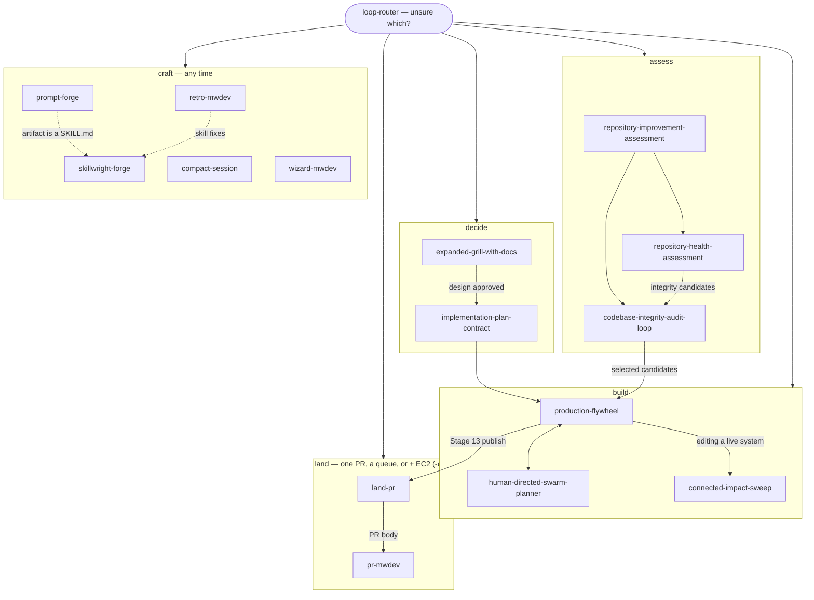

# Capability map

Canonical inventory for this skills repo. **Start here** when you are unsure which skill to run, or when agent memory is fragmented across pastes and local copies.

Inventory = every folder under `skills/` with a root `SKILL.md`.

## Inventory

| Need | Top-level skill | Does **not** do |
| --- | --- | --- |
| Shape one design / approved design package | `expanded-grill-with-docs` | Implement production code; open PRs; choose project priority |
| Turn selected work into a binding execution contract | `implementation-plan-contract` | Select what to work on; write the code |
| Combined health + integrity + architecture assessment from one baseline | `repository-improvement-assessment` | Graph reconciliation, execution, or publication; a health-only grade |
| Grade repository health / establish a baseline | `repository-health-assessment` | Implement fixes; propose architecture direction; review one diff |
| Audit and repair codebase integrity | `codebase-integrity-audit-loop` | Deliver a multi-item queue end-to-end |
| Deliver approved work | `production-flywheel` | Start a new repo-wide report without user queue selection |
| Parallelize a known mission | `human-directed-swarm-planner` | Autonomously pick the mission |
| Change code without breaking neighbours | `connected-impact-sweep` | Decide what the change should be |
| Land a local change or an explicit PR queue, with an optional EC2 release (`-ec2`) | `land-pr` | Build a selected work queue or land/deploy without the user's explicit request |
| Write / repair / optimize prompts | `prompt-forge` | Perform the underlying task; author SKILL.md packages |
| Design / audit / harden a SKILL.md package | `skillwright-forge` | Write ordinary prompts or application code |
| Checkpoint a long session before `/clear` | `compact-session` | Clear context itself; substitute for git commits |
| Write or rewrite a PR body (visual summary, evidence, merge danger) | `pr-mwdev` | Push, open, or merge a PR |
| Generate an interactive wizard for steps only a human can perform | `wizard-mwdev` | Steps the agent can perform itself |
| Retrospect a session to find environment fixes | `retro-mwdev` | Apply the fixes itself (read-only; routes each to its owner) |
| Unsure which applies | `loop-router` | Execute work itself beyond routing |

## When to hand off

| From | To | Trigger |
| --- | --- | --- |
| `loop-router` | any inventoried skill | Need matches a single row above |
| `expanded-grill-with-docs` | `implementation-plan-contract` | Design approved; needs a binding execution contract |
| `expanded-grill-with-docs` | `production-flywheel` | Approved design package reached; user wants delivery |
| `repository-improvement-assessment` | `repository-health-assessment` / `codebase-integrity-audit-loop` / `architecture-improvement-intelligence` | Combined ASSESS projection; children inherit report policy |
| `repository-health-assessment` | `codebase-integrity-audit-loop` | Graded baseline produced integrity candidates to repair |
| `codebase-integrity-audit-loop` | `production-flywheel` | User selected one or more ledger candidates to ship |
| `codebase-integrity-audit-loop` | `human-directed-swarm-planner` | User wants parallel report (`--parallel-report`) or a mission swarm |
| `human-directed-swarm-planner` | `codebase-integrity-audit-loop` | Repo Audit swarm produced a ledger; next is candidate loops |
| `human-directed-swarm-planner` | `production-flywheel` | Mission is a **queue** of separate items, not one milestone |
| `production-flywheel` | `expanded-grill-with-docs` | Design-lane gate A — the default for every queue item |
| `production-flywheel` | `human-directed-swarm-planner` | One milestone needs parallel lanes, not sequential queue items |
| `production-flywheel` | `land-pr` | Stage 13 after the user explicitly requests landing or deployment (queue mode for leftover batches) |
| `land-pr` | itself, with `-ec2` | The landed change (or queue) must also be released to EC2 |
| `land-pr` / `production-flywheel` | `pr-mwdev` | A PR is being created; the caller hands in its evidence for the body |
| `retro-mwdev` | `skillwright-forge` (or the named owner) | A ranked environment fix is accepted |
| `prompt-forge` | `skillwright-forge` | The artifact is a SKILL.md package, not a prompt |
| `prompt-forge` | (exit) | Prompt delivered; do not execute the prompted task unless the user separately asks |

## Shared contracts

Every top-level skill may reference these without redefining them:

| Contract | Path | Owns |
| --- | --- | --- |
| Candidate ledger spine | [`shared/candidate-ledger-spine/`](shared/candidate-ledger-spine/) | Family candidate schema + verifiers (`candidate.schema.json`, `ledger-verify.js`, parity/package checks) |
| Scoring spine | [`shared/REPORT-SCORING.md`](shared/REPORT-SCORING.md) | Candidate schema, scores, priority, report sections/style |
| Requirements ledger | [`shared/REQUIREMENTS-LEDGER.md`](shared/REQUIREMENTS-LEDGER.md) | Trackable requirement/candidate status |
| Rollout contract | [`shared/ROLLOUT-CONTRACT.md`](shared/ROLLOUT-CONTRACT.md) | Implementation / slice handoff shape |
| Swarm lanes | [`shared/SWARM-LANES.md`](shared/SWARM-LANES.md) | Lane roles, captain rules, merge protocol |
| Human decisions | [`shared/HUMAN-DECISIONS.md`](shared/HUMAN-DECISIONS.md) | Categories that block auto mode |
| Loop state | [`shared/LOOP-STATE.md`](shared/LOOP-STATE.md) | Valid next starting points between loops |
| RIA composite scoring | [`shared/ria-scoring/`](shared/ria-scoring/) | Six-dimension composite + ledger priority bands (−10…+22) |
| RIA owner return | [`shared/ria-owner-return/`](shared/ria-owner-return/) | Closed `ria.owner-return@1` envelope |
| Assessment runtime contract | [`shared/assessment-runtime-contract/`](shared/assessment-runtime-contract/) | Parent-facing owner input/output contract |
| Verification baseline | [`shared/assessment-verification-baseline/`](shared/assessment-verification-baseline/) | Shared isolated command/coverage baseline |
| Project intelligence workspace | [`shared/project-intelligence-workspace/`](shared/project-intelligence-workspace/) | `.project-intelligence/` durable root |
| Report election | [`shared/report-election/`](shared/report-election/) | Generate/skip/inherit presentation policy |
| Report presentation | [`shared/report-presentation/`](shared/report-presentation/) | Shared HTML report canvas |

## Known, not yet vendored

`software-engineering-intelligence` and `architecture-improvement-intelligence` remain local/family skills used by RIA but are not yet promoted into `skills/`. Pin them in [`DEPENDENCIES.md`](DEPENDENCIES.md); do not treat them as missing inventory rows.

## Boundaries (do not blur)

1. **Inventory = every `skills/*/SKILL.md`.** Keep packages flat (no accidental `name/name/` nesting). True externals not owned here are listed in [`DEPENDENCIES.md`](DEPENDENCIES.md).
2. **Shared contracts are single sources of truth.** Skills link here; they do not fork scoring formulas or human-decision taxonomies.
3. **Human direction owns mission and queue.** Skills execute authorized work; they do not invent new roadmaps.
4. **Delivery loops ship by opening a PR.** Only `land-pr` merges or deploys, and only when the user explicitly requests it.
5. **Inventoried skills route at inventoried skills first.** Where this repo owns a capability, its skills invoke the in-repo one — an in-repo skill may delegate down to an external companion internally, but the entry point is owned here. This is why the flywheel's design lane targets `expanded-grill-with-docs` and the `-mwdev` forks rather than their upstream parents.

## Validation

- Triggers: [`tests/trigger-tests.md`](tests/trigger-tests.md)
- Boundaries: [`tests/boundary-tests.md`](tests/boundary-tests.md)
- Functional: [`tests/functional-tests.md`](tests/functional-tests.md)
