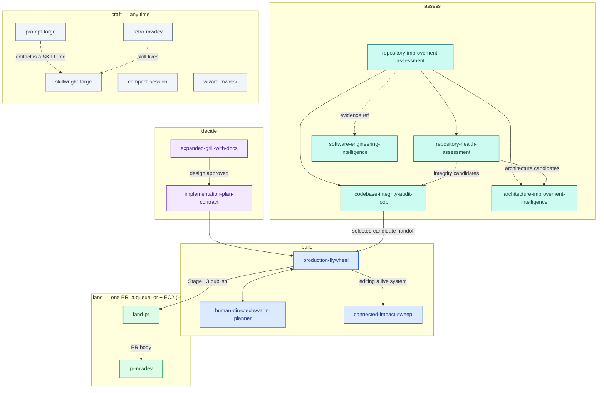

<p align="center">
  <picture>
    <source media="(prefers-color-scheme: dark)" srcset=".github/readme/hero-dark.svg">
    
  </picture>
</p>

<p align="center">
  <strong>A curated operating system for agentic software delivery.</strong><br/>
  <sub>One catalog for capability routing, reusable execution loops, and the contracts they share.</sub>
</p>

<p align="center">
  <a href="https://github.com/markwuenschel-dev/markdev-skills"></a>
  
  
  
</p>

<p align="center">
  <a href="CAPABILITY-MAP.md"></a>
</p>

<p align="center">
  <a href="#get-started">Get started</a> ·
  <a href="CAPABILITY-MAP.md">Capability map</a> ·
  <a href="#install">Install</a> ·
  <a href="DEPENDENCIES.md">Lineage & dependencies</a>
</p>

---

`markdev-skills` is the canonical inventory for a focused set of agent skills: each package owns one clear job, shared contracts stay centralized, and every entry point is invoked directly — pick the skill from the map below.

Every in-repo skill lives under `skills/` with a root `SKILL.md`. External companions are recorded in [`DEPENDENCIES.md`](DEPENDENCIES.md), not copied in wholesale.

## Get started

1. **Find the work in the map below** and invoke that skill directly. The usual flow runs decide → assess → build → land; craft skills apply any time.
2. **Unsure between two neighbours?** Each row in [`CAPABILITY-MAP.md`](CAPABILITY-MAP.md) says what the skill does **not** do, and which skill it hands off to.
3. **Want the catalog locally?** Follow the [installation instructions](#install) to link or copy every package into your agent skill directory.

> The repository favors explicit boundaries: design before delivery, proof before landing, and shared contracts over duplicated rules.

---

## Explore the capability map


### Decide

| Need | Skill |
| :--- | :--- |
| Shape one design / approved design package | [`expanded-grill-with-docs`](skills/expanded-grill-with-docs/) |
| Turn selected work into a binding execution contract | [`implementation-plan-contract`](skills/implementation-plan-contract/) |

### Assess

| Need | Skill |
| :--- | :--- |
| Combined health + integrity + architecture assessment (RIA) | [`repository-improvement-assessment`](skills/repository-improvement-assessment/) |
| Grade repository health, establish a baseline | [`repository-health-assessment`](skills/repository-health-assessment/) |
| Audit integrity read-only: verified candidate ledger, one selected handoff | [`codebase-integrity-audit-loop`](skills/codebase-integrity-audit-loop/) |
| Structural architecture analysis / one-candidate design handoff (RIA architecture owner) | [`architecture-improvement-intelligence`](skills/architecture-improvement-intelligence/) |
| Software Engineering Intelligence snapshot + assessment (explicit request only) | [`software-engineering-intelligence`](skills/software-engineering-intelligence/) |

### Build

| Need | Skill |
| :--- | :--- |
| Deliver authorized work (one item or an action graph) end-to-end | [`production-flywheel`](skills/production-flywheel/) |
| Parallelize a known mission into agent lanes | [`human-directed-swarm-planner`](skills/human-directed-swarm-planner/) |
| Change code without leaving the system incoherent | [`connected-impact-sweep`](skills/connected-impact-sweep/) |

### Land

| Need | Skill |
| :--- | :--- |
| Land one change, or an explicit PR queue | [`land-pr`](skills/land-pr/) |
| Same, plus release the affected service(s) to EC2 | [`land-pr`](skills/land-pr/) with `-ec2` |
| Write or rewrite the PR body a reviewer judges | [`pr-mwdev`](skills/pr-mwdev/) |

### Craft

| Need | Skill |
| :--- | :--- |
| Write / repair / optimize a prompt | [`prompt-forge`](skills/prompt-forge/) |
| Design, audit, or harden a SKILL.md package | [`skillwright-forge`](skills/skillwright-forge/) |
| Checkpoint a long session before `/clear` | [`compact-session`](skills/compact-session/) |
| Script a wizard for steps only a human can perform | [`wizard-mwdev`](skills/wizard-mwdev/) |
| Retrospect a session to fix the agent's environment | [`retro-mwdev`](skills/retro-mwdev/) |

**Boundaries and handoffs:** [`CAPABILITY-MAP.md`](CAPABILITY-MAP.md)  
**External dependencies and lineage:** [`DEPENDENCIES.md`](DEPENDENCIES.md)

---

## How it’s organized

| | |
| :--- | :--- |
| **`skills/`** | One folder per skill — composable, invokable; inventory = every folder with a root `SKILL.md` |
| **`shared/`** | Contracts used across skills — scoring, ledgers, decisions, loop state |
| **`tests/`** | Manual trigger / boundary / functional checklists (Markdown, partially stale). Executable tests live inside each package as `*.test.js` |
| **`scripts/`** | Install helpers |

```
markdev-skills/
├── CAPABILITY-MAP.md          ← boundaries + handoffs
├── DEPENDENCIES.md            ← externals + fork lineage, pinned by source
│
├── skills/
│   ├── expanded-grill-with-docs/            ← decide
│   ├── implementation-plan-contract/
│   │
│   ├── repository-improvement-assessment/  ← assess (combined RIA)
│   ├── repository-health-assessment/
│   ├── codebase-integrity-audit-loop/
│   ├── architecture-improvement-intelligence/
│   ├── software-engineering-intelligence/
│   │
│   ├── production-flywheel/                ← build
│   ├── human-directed-swarm-planner/
│   ├── connected-impact-sweep/
│   │
│   ├── land-pr/                            ← land (queue + EC2 via flags)
│   ├── pr-mwdev/                           ← PR body for land-pr / flywheel
│   │
│   ├── prompt-forge/                       ← craft
│   ├── skillwright-forge/
│   ├── compact-session/
│   ├── wizard-mwdev/
│   ├── retro-mwdev/
│   │
│   ├── agent-executor-pool/                ← mechanism (not directly invocable): bounded worker
│   │   scheduling for health, RIA, integrity, architecture, and production-flywheel
│   ├── loop-router/                        ← dormant experimental prototype; not an entry point
│   │
│   └── wayfinder-mwdev/, diagnosing-bugs-mwdev/, improve-codebase-architecture-mwdev/
│       ← deprecated aliases kept for old invocations (see DEPENDENCIES.md)
│
├── shared/
│   ├── candidate-ledger-spine/   ← family scoring spine (schema + verifiers)
│   ├── evidence-recon/           ← generic evidence packet contract (inline/expedition modes)
│   ├── assessment-acceleration/  ← scheduling, cache, performance receipts
│   ├── ria-scoring/              ← RIA composite + ledger priority bands
│   ├── ria-owner-return/         ← closed owner-return envelope
│   ├── assessment-runtime-contract/
│   ├── assessment-verification-baseline/
│   ├── project-intelligence-workspace/
│   ├── report-election/
│   ├── report-presentation/
│   ├── software-engineering-intelligence/  ← SEI engine (collectors, analyzers, schema validator)
│   ├── REPORT-SCORING.md         ← legacy copy; canonical is candidate-ledger-spine/REPORT-SCORING.md
│   ├── REQUIREMENTS-LEDGER.md
│   ├── ROLLOUT-CONTRACT.md
│   ├── SWARM-LANES.md
│   ├── HUMAN-DECISIONS.md
│   └── LOOP-STATE.md
│
├── tests/
└── scripts/
```

Skills own their procedure. Shared contracts own rubrics once — skills link in rather than restating them. (One known exception: `shared/REPORT-SCORING.md` is an older copy of `shared/candidate-ledger-spine/REPORT-SCORING.md`.)

---

## Install

Symlinks (or, with `--copy` / `-Copy`, copies) **every** skill under `skills/` that has a root `SKILL.md` into your agent skills directory.

**Bash / macOS / Linux / Git Bash**

```bash
./scripts/install-skills.sh
./scripts/install-skills.sh --dest "$HOME/.agents/skills"
./scripts/install-skills.sh --with-shared
```

**Windows PowerShell**

```powershell
.\scripts\install-skills.ps1
.\scripts\install-skills.ps1 -Dest "$HOME\.agents\skills" -WithShared
```

Default destination: `~/.agents/skills`.

> **Runtime caveat.** Instructions-only use works with the default install. The bundled Node scripts are different: they load shared modules from `<skills-dir>/shared/` (for example `require("../shared/…")` from a skill folder). `--with-shared` / `-WithShared` puts `shared/` at `<dest>/../markdev-skills-shared` instead, and the scripts never look there. To run the scripts, install with `--copy` and copy `shared/` to `<dest>/shared`. Some scripts also load canon shared packages that are not vendored here (for example `orchestration-runtime` and `action-graph-execution`; see [`DEPENDENCIES.md`](DEPENDENCIES.md)).

---

## Rules

| | |
| :---: | :--- |
| **1** | Living inventory — every `skills/*/SKILL.md` is first-class; keep packages flat (no `name/name/` nesting) |
| **2** | Pin true externals in `DEPENDENCIES.md` (source · path · version/commit); do not dump unrelated skill universes here |
| **3** | Change shared rubrics under `shared/`, not per skill |
| **4** | A `-mwdev` package sets its frontmatter `name` to its suffixed directory name; a fork also credits its upstream parent in `DEPENDENCIES.md` |
| **5** | Keep the public catalog focused, attributable, and coherent as the inventory evolves |

---

<p align="center">
  <sub>Focused catalog · explicit boundaries · proof-driven delivery</sub>
</p>
