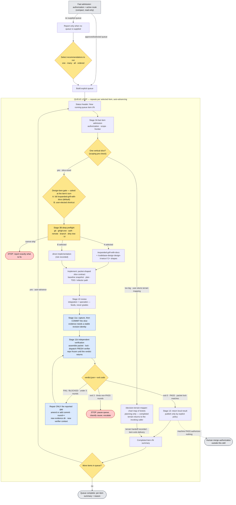

# Production Flywheel

Use this skill as the execution adapter for a router-approved action graph or a user-selected local delivery queue. It runs isolated preflight, implementation, review, and an **independent-verification round** for each authorized action. It returns execution and verification references to the lifecycle caller; it never owns a lifecycle transition or automatically publishes a branch or PR.

At every D7 wave boundary the flywheel must honor the caller's explicit stop
probe. A requested stop drains the active wave, completes independent
verification and Stage 15 integration, then returns the boundary receipt and
refuses every successor claim with `STOP_USER_REQUESTED`; it may not be
interpreted as an outer-router-only flag.

The flywheel owns the delivery item and the lifecycle. It does **not** grade its own work: Stage 11 hands the completion claim to `/independent-verification`, which dispatches a fresh verifier that never sees this session's reasoning and returns a computed verdict. Shipping is authorized by that verdict artifact, not by the assistant's confidence.

The queue is the point. Once you select an ordered batch, that selection authorizes the assistant to work the whole batch end-to-end. It stops only when the queue is complete or a real blocker prevents safe delivery.



Fast admission (S0) runs once per session and contains only authorization, mode, and next-capability checks. Deep session readiness runs after a queue and lane/scoping choice exist, before any mutation; Stage 3B repeats the authoritative repository/frontier checks per item. Independent no-write probes may run concurrently, but missing gates still block. Two inner loops still nest inside delivery: the **TDD loop** cycles per behavior, and its **failure interrupt** diverts to `/diagnosing-bugs-mwdev` when a task goes red, flaky, slow, or unexplained, then resumes.

## Model invocation policy

This skill is model-invokable only inside an existing authorization: the user asked for production-flywheel, or an approved implementation contract / selected candidate needs end-to-end delivery. Never self-invoke to start a new repo-wide report, pick a batch, or build a queue — the user starts the flywheel and selects the queue. When invoked with an approved implementation contract, an explicitly recorded current user selection, or a selected action/action-set carrying the authorization envelope (`authorization_ref`, issuer, mission/scope, exact item/action IDs, lifecycle status plus expiry/fencing, permitted mutation, and publication policy) already in hand — including candidates the user selected from a family candidate ledger (`REPORT-SCORING.md` schema, e.g. out of a `--parallel-report` run) — treat that selection as the queue and skip the report stage; run fast admission, print the queue, and reach the item's A/B question before deep readiness checks. A report recommendation, design approval, stale pointer, or unfenced candidate is not enough. The report exists to create a queue the user hasn't yet selected. Ledger candidates arrive with lane evidence, scores, and blockers: carry them into the item's design gate instead of rediscovering them, and treat a non-empty `blocked_by` as a real blocker for that item.

## Operating modes

Manual queue mode (the flow described above) is the default: the user picks an ordered queue from a printed report, and this skill works it top to bottom.

`--graph` is a legacy candidate-ledger compatibility path. It accepts only an explicitly supplied legacy spine-v3 ledger and is never the target for RIA or RGO output. It cannot be selected implicitly by a router or model. Read [GRAPH-MODE.md](../GRAPH-MODE.md) in full before using it.

`--graph` is user-elected, never model-elected — the same posture as batched shipping (Stage 2's *Ship granularity*) and the Decision Terrain branch. The assistant may recommend it when a caller hands over a ledger with `depends_on` edges already populated, but the user chooses to run it.

The legacy explicit `--graph` mode is intentionally serial: one item executes
at a time in the computed frontier order. The canonical `--action-graph` mode
is separate and supports D7 batches of independent frontier actions; its
default `N=1` behavior remains serial. The legacy mode does not disable or
replace the canonical parallel path.

`--action-graph` is the canonical execution path. It consumes a `shared/action-graph-execution` `execution_graph` envelope by immutable reference from the lifecycle caller; it does not reinterpret RGO output or author graph nodes. Read [ACTION-GRAPH-MODE.md](../ACTION-GRAPH-MODE.md) in full before Stage 2. Stage 15 is an integration boundary after execution evidence exists; it is not an ASSESS or dispatch artifact.

## Hard Rules

- Run fast admission before the first interaction, then run the full active-route dependency and publish preflight before mutation. Do not silently improvise missing routed skills.
- Produce the numbered HTML architecture report first only when no approved contract or already-selected candidates exist (see *Model invocation policy*), which stand in for the report stage. Either way, do not change production code before an explicit current user/router selection is recorded in the authorization envelope.
- **Ask which recommendations to run.** After the report, the user picks one item, multiple items, all items, or a specific order. That selection becomes an explicit, visible queue.
- **Process authorized local work sequentially and automatically.** After the batch is selected, work each item through its local verification return and advance without a publication side effect. Stop for an explicit publish request, an empty queue, or a real blocker.
- **`/expanded-grill-with-docs` is the default design lane, always.** "The design seems obvious / fleshed out / mechanical" is **not** permission to skip it. See *The design-lane gate is never the model's to skip*.
- **The assistant may not silently elect a fast path.** It must never decide on its own that the design contract is complete, that direct delivery is allowed, that a lightweight lane applies, or that `/expanded-grill-with-docs` or the design-it-twice pass in `/codebase-design` is unnecessary. It may *recommend* a shortcut, but the user must choose it. The default/first option is always the full process.
- Ask the design-lane question **when the item reaches its turn in the queue**, immediately after fast item admission and before deep preflight — not five times upfront — unless the user asks to decide all lanes ahead of time.
- **Scope each candidate before its gate.** If a candidate is too big for one vertical slice, it isn't gate-ready — recommend the **user-elected** `/decision-terrain-mapper` branch to decompose it (plan, don't build); its decision tickets do **not** become Flywheel implementation items. Never model-elect terrain mapping, and never push a too-big candidate straight into implementation; completed terrain returns to the invoking caller for a separate decision. See *The Decision Terrain branch*.
- Use `/tdd` for new-behavior tasks; use the behavior-preserving **refactor path** (characterize → stay green) for mechanical or consolidation tasks.
- Use `/diagnosing-bugs-mwdev` when work is red, flaky, slow, or unexplained.
- **Commit before verifying; publish only by explicit policy.** The slice is committed at Stage 11, verified at that committed revision, and then remains local until a caller supplies a publish policy. Nothing writes to the repository between verifier dispatch and its verdict.
- **Publication is never automatic.** `local_only` records local completion only; `push_allowed` permits an explicit push request; `pr_allowed` permits an explicit PR-creation request after push. Neither policy authorizes merge.
- **Merge is human-only.** Do not merge a PR unless the user explicitly says merge.
- **The assistant never grades its own work.** Completion is a verdict from `/independent-verification`, not a claim from this session. "The tests pass", "I verified it", and "this is ready" are inputs to Stage 11, never results of it. See *Stage 11 is not the model's to self-certify*.
- **Only a verified `PASS` authorizes Stage 13.** The ship gate is exactly two mechanical checks — exit `0` from `verdict.py compute`, and `verdict.json` carrying `"verdict": "PASS"` whose `packet_lock_sha256` matches the packet for the revision being shipped. No prose, no partial credit, no "PASS with caveats".
- **Apply the canonical verification-freeze invariant.** See [ACTION-GRAPH-MODE.md](../ACTION-GRAPH-MODE.md#canonical-verification-freeze-invariant): from dispatch until the verdict returns, do not mutate the action's named worktree, revision, branch, or verification scope. D7 peers require separately isolated worktrees and disjoint declared resources; never move the revision named by an in-flight packet.
- **A graph-mode queue item is still one slice, and a `depends_on` cycle is a slicing defect, not a schedule to solve.** Under `--graph` (see *Operating modes* and [GRAPH-MODE.md](../GRAPH-MODE.md)), refuse a cycle outright and route its members back to their design gate or to `/decision-terrain-mapper` — never attempt to order two items that depend on each other.
- **An action-graph queue item is still one action, and a `hard_requires` cycle is refused outright exactly as a `depends_on` cycle is refused in candidate-graph mode.** Under `--action-graph` (see *Operating modes* and [ACTION-GRAPH-MODE.md](../ACTION-GRAPH-MODE.md)), a cycle among actions is never solved as a scheduling puzzle — name the cycle's members and route them back to their design gate or to `/decision-terrain-mapper`, the same response required above for a `depends_on` cycle.
- **An integration reassessment never merges and never amends a participant's own verdict.** Under `--action-graph` (see Stage 15 and [INTEGRATION-REASSESSMENT-STAGE.md](../INTEGRATION-REASSESSMENT-STAGE.md)), reassessing a cohort of already-`complete` actions in combination never pushes a merge to the default branch, and never edits, recomputes, or overwrites any participant's own `verdict.json`. A finding's treatment can hold a candidate open, mint a brand-new action node, or escalate a real human decision — it cannot retroactively change what an earlier, independent Stage 11 round already proved about that action on its own.
- If the standard runner cannot exercise the slice, build a red-capable harness and **declare it as a packet gate** — do not guess, and do not verify through a command the packet never declared.
- Capture durable knowledge in one authoritative place.
- Per-item preflight must confirm the repo can actually ship a PR **before implementation begins** for that item. If it cannot, stop and say exactly what to fix.

## The design-lane gate is never the model's to skip

This is the rule the whole workflow exists to enforce.

The default design lane for **every** selected item is:

```text
Run /expanded-grill-with-docs.
```

A shortcut (direct implementation with no grill) is allowed **only when the user explicitly chooses it at the item's turn.** The assistant:

- must present the full `/expanded-grill-with-docs` lane as option **A**, the default and first option
- may present a shortcut as option **B** and may recommend it with reasoning
- **must not choose B on the user's behalf**, and must not treat "this design looks complete" as authorization to skip grilling
- if the user picks B, records that the user explicitly elected the shortcut and states the risk being accepted

There is no model-elected "design contract is complete," "direct delivery is allowed," "lightweight lane applies," or "grill/design-it-twice is unnecessary." Those decisions belong to the user.

## Stage 11 is not the model's to self-certify

The design-lane gate protects the *front* of an item from the assistant's confidence. Stage 11 protects the *back* of it, and by the same logic: the agent that wrote the code never grades it.

This is a structural rule, not an attitude:

- The flywheel session is the **producer**. It assembles the packet, dispatches, and consumes the verdict. It never grades a criterion, even when certain.
- The **verifier** is a fresh subagent that receives the packet and nothing else — no conversation, no summary of why the change is correct, no note about which test is flaky, no apology for a messy diff. Every such addition is producer reasoning reaching the verifier, and it turns an independent round into a rubber stamp.
- The **producer or a fresh repair agent** fixes failures. The verifier never edits; the producer never grades. If one agent starts doing both, stop and restart the round.
- The **human** authorizes the merge. A machine `PASS` authorizes opening a PR and nothing further.

`verification-before-completion` remains useful as a producer-side smoke check during Stage 9 — run the command, read the output, don't claim what you haven't run — but it is **prose discipline that produces no artifact and has no independence**. It is not the completion gate and never satisfies Stage 11. Do not substitute one for the other.

There is no model-elected "this one is obviously fine," "the diff is too small to verify," "review already covered it," or "the verifier would just agree." Those are exactly the items that reach `PASS` without evidence.

## The Decision Terrain branch — a candidate too big for one slice

The flywheel's unit is **one vertical slice per item**. Most report candidates fit that. Some don't: an `unresolved` candidate can be a multi-session architectural change with interdependent unknowns — too big to grill into a single slice contract, and too foggy to slice at all.

That candidate is not ready for the A/B design-lane gate. Route it to `/decision-terrain-mapper` **to plan, not to build**: Decision Terrain Mapper charts the candidate as a map of agent-sized investigation tickets with blocking relationships, resolved one per session (its own tickets route to `/research`, `/prototype`, `/expanded-grill-with-docs`, and `/domain-modeling`). Decision Terrain Mapper produces **decisions, not deliverables** — it sits upstream of implementation, never inside it.

Do **not** append Decision Terrain Mapper decision tickets to this Flywheel queue or convert them directly with `/to-tickets`. The terrain is decision state, not delivery work. When the map completes, Decision Terrain Mapper emits its caller return; any later implementation requires a separate exact authorization and still receives the normal design/slice gates.

**This branch is user-elected, never model-elected.** Like the A/B gate, the assistant may *recommend* terrain mapping for a candidate it judges too big, but the user chooses it. Charting a map is a scoping decision, not a shortcut — it adds planning rigor rather than skipping it.

## Human Input Gate Rule

Selecting the ordered batch **is** the human authorization for the whole queue: the assistant works every selected item end-to-end and auto-advances between them without re-asking.

Within that authorization:

- The **design-lane A/B question is a required per-item gate** — the user answers it (A or B) when the item reaches its turn. The assistant never answers it for them.
- The **scoping/terrain-mapping election is user-elected**, like the A/B gate: the assistant may recommend terrain-mapping a too-big candidate but never charts a map, nor pushes the candidate into implementation, on the user's behalf.
- **Never merge a PR** without an explicit "merge" from the user. Opening the PR is authorized by batch selection; merging is not. A `PASS` from Stage 11 does not soften this — `verdict.json` always reports the human gate as required and unsatisfied, whatever else it says. Do not treat silence, "sounds good", or a thumbs-up on an unrelated message as authorization. If the user declines to read the diff, record that the gate was **waived and by whom**; never record it as satisfied.
- **A Stage 11 `FAIL` or `BLOCKED-UNVERIFIABLE` blocks the item, not the queue.** Repair the reported gap and re-verify in a new round without asking — that is ordinary in-item work, authorized by batch selection.
- **A Stage 11 `ESCALATE` (exit 3, three consecutive non-PASS rounds) pauses the queue** and asks. Do not start round four. Three rounds failing the same way is usually evidence about the requirement or the criterion, not the implementation.
- A **real blocker** (can't ship, `ESCALATE`, verification infrastructure that cannot be repaired, irreversible/high-risk decision surfaced mid-item) pauses the queue and asks. A finished PR is not a blocker — keep going.
- If the user is unavailable at the design-lane gate, do **not** silently pick B. Hold the item (and the queue) and report what's needed. The full-grill default is only "safe to auto-proceed" if the user has pre-authorized A for the batch.

## Stage 0 — Staged dependency & publish preflight

This contract follows the canonical staged procedure in [references/queue-and-preflight.md](queue-and-preflight.md). Stage 0A performs only fast admission before the first interaction. The checks in this section are Stage 0B: run them after a queue and the current lane/scoping choice exist, and before any mutation. Independent read-only probes may run concurrently.

### Stage 0A — Fast admission

Use the compact authorization, mode, selected-reference, and next-capability probe defined in `queue-and-preflight.md`. Do not load future branch capabilities or run IV, GitHub, remote, JUnit, or publish checks before the first report/selection/design question.

### Stage 0B — Full active-route preflight

#### Skill dependency preflight

Check whether the routed skills required by the active route are available in the current agent environment before mutation. The entries below are a routing inventory, not a startup checklist; do not load unselected branches.

Required for the active route:
- `expanded-grill-with-docs` when option A/default is selected;
- `independent-verification` (Stage 11 — the completion gate; there is no fallback that preserves independence);
- `tdd` for new behavior, or the documented characterization/refactor path for behavior-preserving work;
- `architecture-improvement-intelligence` only for the report-first path;
- `to-tickets` only when no valid Slice Contract fallback is available;
- `diagnosing-bugs-mwdev` only when behavior is red, flaky, slow, or unexplained.

Conditional route inventory (load only when selected):
- `codebase-design` (design-it-twice technique)
- `codebase-integrity-audit-loop` (source of `--parallel-report` ledger candidates; the family scoring spine is `shared/candidate-ledger-spine`)
- `remediation-graph-optimizer`, `human-directed-swarm-planner` (typical ledger sources for `--graph` mode — see *Operating modes* and [GRAPH-MODE.md](../GRAPH-MODE.md); not required unless `--graph` is set)
- `shared/action-graph-execution` (via `ACTION_GRAPH_VERIFY_PATH` override — required only when `--action-graph` is set; see *Operating modes* and [ACTION-GRAPH-MODE.md](../ACTION-GRAPH-MODE.md))
- `decision-terrain-mapper` (decompose a candidate too big for one slice — see the Decision Terrain branch)
- `research`, `domain-modeling` (support the Decision Terrain branch's ticket types; the grilling and design types both resolve through `expanded-grill-with-docs`, already Required above)
- `prototype`
- `triage`
- `writing-plans`
- `executing-plans`
- `production-campaign` and `agent-executor-pool` for a closed authorized multi-action set
- `requesting-code-review`
- `receiving-code-review`
- `verification-before-completion` (producer-side smoke discipline during Stage 9 — **not** a substitute for the Stage 11 round)
- `land-pr` (**post-authorization only** — it merges with `gh pr merge --merge --delete-branch`; supplied PR numbers select its serial queue mode. It is what the user reaches for *after* granting the human gate, never Stage 13's helper. Stage 13 pushes and opens the PR directly.)

Fallback rule: if a required or conditional skill is not installed as a routed command but its `SKILL.md` can be read from `$HOME/.agents/skills/<skill-name>/SKILL.md`, read that file and follow it directly, and say so explicitly: "The routed command isn't installed here, but I found the shared skill file and will follow it directly."

Gate: every required skill is available as a routed command, or its shared `SKILL.md` was read directly, or a named fallback is stated. If a required skill is missing with none of those, stop. Do not silently improvise.

#### Independent-verification tooling preflight

Stage 11 runs real tooling, not a prompt. Discovering it is missing at verification time is indistinguishable from a verification failure, so classify it now.

`$IV` throughout this skill is the `independent-verification` skill directory — `$HOME/.agents/skills/independent-verification`, the same convention the fallback rule above uses. Resolve it explicitly rather than relying on `${CLAUDE_SKILL_DIR}`: while the flywheel is the running skill, that variable points at *this* package, not IV's, so IV's own documented `$SD` commands do not transplant here unchanged.

Check:

- **`python` 3.8+ and `git` on `PATH`.** IV deliberately has no third-party dependencies; if `python` is missing, every round is `BLOCKED-UNVERIFIABLE`.
- **The scripts are readable:** `$IV/scripts/preflight.py`, `run_gate.py`, `snapshot.py`, `ratchet.py`, `verdict.py`, **and `_iv.py`** — the shared module every one of the others imports. Omitting it is how this preflight passes while the tooling is unusable, which is the exact failure it exists to prevent.
- **The packet/protocol resources are readable:** `$IV/assets/verification-packet.json` and `$IV/references/verifier-protocol.md`, both consumed when Stage 11 assembles and dispatches the independent packet.
- **The `independent-verifier` agent type is installed.** It lives at `$IV/assets/independent-verifier.agent.md` and is **not live where it sits** — it must be copied to `.claude/agents/independent-verifier.md` (project) or `~/.claude/agents/independent-verifier.md` (personal), dropping the `.agent`. If it is absent, dispatch falls back to `general-purpose`, which has full tool access including `Edit` — the verifier's inability to touch the code stops being mechanical and becomes an instruction it could ignore. Say so explicitly rather than proceeding silently; `compute` still catches post-gate repository changes, but that is a backstop, not the guarantee.
- **Receipt sealing.** If `IV_RECEIPT_KEY` is set from somewhere this agent cannot read or write, records are MAC-sealed and `tamper_evidence` reads `hmac`. Without it the tooling still runs and still catches edited records, but reports `chain-only`. Classify which one this session will produce and state it — do not imply a guarantee the setup cannot make.
- **The repo emits JUnit XML** from at least one gate (`pytest --junitxml`, `jest --reporters=jest-junit`, `vitest --reporter=junit`, `go-junit-report`, `dotnet test --logger junit`). Without a test signal the ratchet compares nothing, and a packet is `BLOCKED-UNVERIFIABLE` unless it deliberately sets `allow_no_test_signal`.

Optional but cheap once per machine, to confirm the tooling itself is sound:

```bash
python $IV/scripts/selftest.py -v
```

Gate: `python` and `git` are present, the IV scripts and packet/protocol resources are readable, the verifier agent type is either installed or its absence is reported with the consequence named, and the receipt mode (`hmac` / `chain-only`) is stated. If `python` is missing, say plainly that Stage 11 cannot produce a verdict on this machine, and let the user decide whether to continue with a queue that can only reach `BLOCKED-UNVERIFIABLE` — never quietly downgrade Stage 11 to a self-check.

#### Baseline publish capability

Discovering that `gh` or push auth is missing when it's time to ship is too late. Once a queue exists and the current lane/scoping choice is known, classify baseline publish capability so the user knows the ceiling before any work begins:

- `publish-capable`: remote exists, push auth works or is expected, PR tooling/auth exists
- `push-only`: push appears possible, but PR creation tooling/auth is missing
- `local-only`: no remote or no push/auth path
- `unknown`: cannot determine safely yet

The authoritative ship check runs **per item** in the deep per-item preflight (Stage 3B below), because branch/auth/tree state can change between items. This session-level pass is an early warning, not a reason to delay the first design-lane question. If it shows `local-only` or missing `gh`, say so before mutation and preserve the exact blocker.

## Stage 1 — Report

### Approved or already-selected path

When the invocation already supplies a valid approved implementation contract, an explicitly recorded current user selection, or a selected action/action-set with the required authorization envelope, treat that supplied selection as the queue. Print the queue and proceed directly to the selected-candidate summary and the Stage 4 design-lane question; do **not** generate an architecture report or ask the recommendation-selection prompt again. A report recommendation, design approval, stale pointer, or unfenced candidate cannot substitute for that selection. If a supplied selection is present but invalid, stale, or unfenced, return `MISSING_DELIVERY_AUTHORIZATION`; do not generate a replacement report or scan for other work. A bare `--action-graph` envelope still uses its computed frontier prompt, but never runs the report-first path.

For the report-first manual path only (no valid authorized selection is supplied), run `/architecture-improvement-intelligence`.

Gate:
- A self-contained HTML architecture report exists and its absolute path is printed.
- The report contains **numbered** deepening candidates (`1..N`).
- Each candidate names the module, interface/seam friction, expected leverage, expected locality, and testability impact, scored per the family scoring spine in `shared/candidate-ledger-spine`.
- No production code has changed.
- The report's Mermaid diagrams render without syntax errors, and ugly candidate names do not break the page (the report uses the architecture owner's canonical Mermaid-safe helper).

Then ask which recommendations to run (Stage 2). Do not change production code yet. The approved/already-selected path does not run this report or prompt again.

## Stage 2 — Batch selection & queue

Ask, verbatim in intent:

```text
Which recommendations do you want to run?

You can answer with:
- one number: 3
- multiple numbers: 1, 4, 5
- ordered sequence: 4 then 1 then 3
- all
```

Parse the answer:

- **one number** → a one-item queue
- **multiple numbers** → a queue in the order given (comma order is the run order)
- **ordered sequence** (`4 then 1 then 3`) → a queue in exactly that order
- **all** → every candidate, in report order (confirm the order if the user didn't specify one)

Then print an explicit, visible queue:

```text
Selected queue:
1. [candidate name]
2. [candidate name]
3. [candidate name]
```

This queue **is** the authorization to proceed through every item automatically. Do not ask "shall I start?" or "shall I continue?" between items.

The queue is editable mid-run: the user can reorder, drop, or insert items at any time Apply the edit at the next item boundary, reprint the updated queue, and keep going — a queue edit is a steering input, not a stop.

### Ship granularity

One PR per item is the default. The user can elect **batched shipping** instead — the whole queue or named groups, each group sharing one branch and one PR — in the selection message or at any item boundary (a granularity change applies only to items not yet shipped). When the queue is long (≈5+ items) or several items look small, confirm granularity at the first natural stop (usually item 1's design-lane question, or the upfront exchange if the user decided all lanes ahead of time) rather than silently defaulting into a PR-per-item run. The model may recommend groupings by module or theme, but the election is the user's — never model-elect batching. Batching moves only *where Stage 13 runs*: every per-item stage and gate still runs per item, and a batched item's completion footer reads `PR: ships with group <name>` until the group PR opens.

### Graph mode queue

When `--graph` is set (*Operating modes*), this section's prompt and the "Selected queue" print above are both replaced. Read [GRAPH-MODE.md](../GRAPH-MODE.md) for the full mechanics; in outline:

1. Ingest the ledger and validate it through `shared/candidate-ledger-spine/ledger-verify.js` exactly as any other candidate source; refuse to proceed if it does not validate clean.
2. Refuse a `depends_on` cycle outright (see the Hard Rules bullet above).
3. Compute the eligible frontier per the spine's own eligibility gate and stable comparator (`REPORT-SCORING.md` `## Eligibility and stable ranking`) — this skill never invents a second ranking.
4. Print the frontier — eligible items ranked, blocked items listed with what blocks each — and let the user pick within it, or pre-authorize "top-ranked each time" for the rest of the run.
5. Persist run state to `.verification/graph/state.json`, which is **never authoritative**: every completion claim is re-derived from `verdict.json` on resume, never trusted from the state file alone.

Ordering is computed, not user-typed, which is a real reduction in control from manual mode's numbered-answer queue — say so plainly when offering `--graph`. Every item still passes its own Stage 4 A/B gate at its turn; nothing here shortcuts that. Batched shipping and `--graph` combine only across independent frontier nodes — a batched group stays internally sequential, one shared branch with per-item commits, exactly as *Ship granularity* above already requires.

### Action-graph mode queue

When `--action-graph` is set (*Operating modes*), this section's prompt and the "Selected queue" print above are both replaced, sibling to the `--graph` replacement above. Read [ACTION-GRAPH-MODE.md](../ACTION-GRAPH-MODE.md) for the full mechanics; in outline:

1. Ingest the envelope and validate it through `ActionGraphVerify.verifyExecutionGraph` exactly as any other candidate source; refuse to proceed if it does not validate clean.
2. Refuse a `hard_requires` cycle outright (see the Hard Rules bullet above) — never solved as a scheduling puzzle.
3. Compute the frontier per the three distinct edge-readiness rules — `hard_requires`, `decision_requires`, `verification_requires` — never one flattened `depends_on`.
4. Print the frontier: ready items ranked, blocked items listed (never dropped) using `explainGateBlockers`-shaped reasons for verification-blocked items and "waiting on human decision `<id>`" for decision-blocked items, and let the user pick within it, or pre-authorize "top-ranked each time" for the rest of the run.
5. Persist run state via `shared/action-graph-execution`'s `state-store.js` to `.verification/action-graph/state.json` — the sibling convention to `.verification/graph/state.json`, gitignored the same way. This is read-then-reverify on resume, never read-then-trust, exactly like the candidate-graph path above.

Ordering is computed here too, for the same reason `--graph` states above. Every action still passes its own Stage 4 A/B gate at its turn; nothing here shortcuts that. Batched shipping and `--action-graph` combine only across independent frontier actions — a batched group stays internally sequential, one shared branch with per-item commits, exactly as *Ship granularity* above already requires.

### Per-item status header

At the start of each item, print:

```text
Now running queue item 2/5: [candidate name]
```

### Per-item completion footer

At the end of each item, print:

```text
Completed queue item 2/5:
- Branch:
- PR:
- Verification: PASS | FAIL | BLOCKED-UNVERIFIABLE | ESCALATE (exit code) · round n of 3
                 | n/a — decision-terrain item, planning only, never reached Stage 11
- Evidence: <evidence_dir> · packet lock <sha> · tamper_evidence: hmac | chain-only
- Tests:
- Notes:
Moving to item 3/5.
```

Then move immediately to the next item. Do not ask whether to continue unless there is a real blocker.

### Selected-candidate summary (per item, at its turn)

When an item reaches its turn, summarize it before the design-lane gate:

```markdown
## Selected candidate

**Module/seam:**
**Current friction:**
**Expected leverage:**
**Expected locality:**
**Risk:**
**Staleness:** did earlier queue items ship changes to this candidate's modules? (untouched / touched — summarize)
**Lane recommendation:** full grill (A) / user-elected shortcut (B) / Decision Terrain Mapper (too big for one slice) — with reasoning
```

If earlier items materially changed this candidate's premise, say so and let the user re-confirm, re-scope, or drop it before the gate — do not grill a stale premise. (This is the same staleness rule Stage 14 applies to leftover candidates, applied inside the running queue.)

## The queue loop

For each item in the queue, in order:

1. **Fast item admission** (Stage 3A) and the selected-candidate summary — confirm the item is still authorized and prompt-ready without running network or toolchain probes.
2. **Scoping pre-check + design-lane gate** (Stage 4) — confirm the candidate is one slice (else recommend `/decision-terrain-mapper` to decompose it), then ask the A/B question immediately. Do not choose B on the user's behalf.
3. **Deep per-item preflight** (Stage 3B) — run the GitHub CLI, ship-capability, frontier, branch, and dirty-tree checks before any mutation.
4. **Design process** (Stage 5) — grill / design-it-twice / prototype / triage as selected, **or** `/decision-terrain-mapper` if the scoping pre-check routed here (planning only — the item exits Flywheel after the terrain handoff, Decision Terrain Mapper owns the multi-cycle map, and completed terrain returns to the invoking caller; it never reaches Implement/Ship here).
5. **Implement** (Stage 6–9) — slice, plan, deliver via TDD or the refactor path.
6. **Review, then verify independently** (Stage 10–11) — review feeds the round; a fresh verifier returns the verdict. The repository is frozen from dispatch until the verdict lands, so the next item cannot begin here.
7. **Capture & ship** (Stage 12–13) — capture durable knowledge, then commit, push, open the PR **only on a verified `PASS`**. Never merge.
8. **Advance** (Stage 14) — print the completion footer and move to the next item automatically.

Stop the loop only when the queue is empty or a blocker prevents safe delivery.

## Stage 3 — Per-item preflight

Stage 3 is split so the design-lane question is not held behind slow, no-write checks. Stage 3B remains mandatory before implementation for **each** selected item; nothing in Stage 3A authorizes mutation.

### Stage 3A — Fast item admission

Before the Stage 4 question, confirm the item's authorization identity and declared scope are still readable. Under `--graph` or `--action-graph`, recompute enough frontier state to ensure the item can be shown as prompt-ready; the authoritative frontier check is repeated in Stage 3B immediately before mutation. Print one compact admission receipt and move to the design-lane question. Do not run `gh`, network, IV, JUnit, or full repository probes here.

### Stage 3B — Deep per-item preflight

Run before implementation for **each** selected item. Its job: confirm the repo can actually ship a PR, and confirm the working tree is in a known state — before any code changes for this item. Issue independent read-only commands as one concurrent probe batch where the runtime permits, then report one compact receipt.

**Decision-Terrain-bound items:** if the selected-candidate summary (Stage 2) recommended `/decision-terrain-mapper` for this item — planning only, no PR this pass — the ship-capability checks below are **informational, not blocking**; terrain mapping opens no PR, so missing `gh`/auth/remote does not stop it. Still run the working-tree check so the map work starts from a known state.

Run these checks (support both `gh` and `gh.exe` on Windows — try `gh`, fall back to `gh.exe`):

```bash
git --version
gh --version          # or: gh.exe --version
gh auth status        # or: gh.exe auth status
git remote -v
git status --short
git branch --show-current
```

Interpret:

- **`git` missing** → hard stop; the workflow can't operate. Tell the user to install Git.
- **`gh` / `gh.exe` missing** → stop before implementing this item and tell the user exactly what to install (GitHub CLI). Do not start work you can't ship.
- **`gh auth status` unauthenticated** → stop and tell the user to run `gh auth login`. Name the exact command.
- **No remote (`git remote -v` empty)** → stop and report; there's nowhere to push a PR. (If the user explicitly wants local-only for this item, record that as a user-elected exception.)
- **Detached HEAD / unexpected branch** → note it; you'll create a fresh feature branch for the slice anyway.

### Working-tree check

Inspect `git status --short` before starting the item:

- **Clean** → proceed.
- **Dirty** → summarize the dirty files and decide whether they are **expected** from this workflow (e.g. an in-progress branch from the previous queue item that was already pushed) or a **blocker** (unrelated uncommitted changes that would contaminate this slice). If it's a blocker, stop and ask; if it's expected and explained, proceed and record why.

Do not defer any of this to ship time. The whole reason it lives in preflight is so the assistant never reaches the end of an item only to discover it cannot open a PR.

**Under `--graph`:** confirm this item is still in the computed eligible frontier — i.e. every `depends_on` candidate is `completed` — before proceeding. An item that was eligible when queued but whose dependency has since been reset to blocked (Stage 13's group-branch-reset case) is not ready; recompute the frontier (Stage 14) rather than starting it.

**Under `--action-graph`:** confirm the item's `action_id` is still in the recomputed frontier — recompute via `ActionGraphVerify.verifyExecutionGraph` (or `computeFrontier`), never trust a cached one — before proceeding.

Gate:
- `git` present; `gh`/`gh.exe` present and authenticated, or the exact blocker is reported and the queue is paused.
- A remote exists, or a user-elected local-only exception is recorded.
- The working tree state is known and either clean or explained.
- Under `--graph`: this item is currently in the eligible frontier.

## Stage 4 — Design-lane gate (per item, at its turn)

**Mandatory for every item. The default is the full grill. The assistant must not skip it or choose the shortcut on the user's behalf.**

**Scoping pre-check (before the A/B gate).** Confirm the candidate is actually one vertical slice. If it's too big for one slice/session — interdependent unknowns, multi-session architectural scope — it isn't gate-ready: recommend the Decision Terrain branch to decompose it first, and let the user elect it (see *The Decision Terrain branch*). If the user elects terrain mapping, this item leaves Flywheel rather than reaching the A/B gate. Decision Terrain Mapper owns the map and returns completed terrain to the invoking caller.

First classify the candidate as `mechanical` / `partly designed` / `unresolved`, then present the gate verbatim in this shape:

```text
This candidate looks [mechanical / partly designed / unresolved].

Default option:
A. Run full /expanded-grill-with-docs before code.

Optional shortcut:
B. Treat the existing design as sufficient and proceed with direct implementation.

My recommendation:
[explain briefly]

Choose A or B.
```

- **If the user chooses A** → run `/expanded-grill-with-docs`. If multiple interface shapes remain plausible, run the design-it-twice pass in `/codebase-design` (see its `DESIGN-IT-TWICE.md`).
- **If the user chooses B** → record explicitly: "User elected the direct-implementation shortcut for this item," and state the risk being accepted (what grilling would have de-risked). Then proceed to implementation.
- **If the user doesn't answer** → hold this item. Do not pick B. (Only auto-run A if the user pre-authorized "A for the whole batch.")

There is no third, model-elected path. Do not infer B from the design looking complete. After the user answers A or B, return to the queue loop's Stage 3B deep preflight; enter the selected design/implementation lane only after that preflight passes (or its planning-only exception is recorded).

## Stage 5 — Design process

Run the lane the gate selected. **A is the default lane; Prototype and Triage are sub-lanes of A**, entered by their triggers rather than a separate gate question — pick Prototype when state/model/UI must be *felt*, Triage when the work starts from an existing issue/PR, otherwise grill. Decision Terrain Mapper is entered only when the scoping pre-check routed here; B only when the user elected it at the gate.

- **A (default) — grill:** Run `/expanded-grill-with-docs`. See [branches/design.md](../branches/design.md). If 2+ interface shapes are plausible, run the design-it-twice pass in `/codebase-design` (see its `DESIGN-IT-TWICE.md`).
- **Prototype** (sub-lane of A, when state/model/UI must be felt): Run `/prototype`. See [branches/prototype.md](../branches/prototype.md).
- **Triage** (sub-lane of A, when work starts from an issue/PR): Run `/triage`. See [branches/triage.md](../branches/triage.md).
- **Decision Terrain Mapper (user-elected, pre-slice):** the scoping pre-check found the candidate too big for one slice. Run `/decision-terrain-mapper` to chart it into a map of tickets; planning only. **This item exits the Flywheel delivery loop here — do NOT proceed to Stage 6 (Slice) or Stage 13 (Ship).** Record the Decision Terrain map/handoff reference as planning-deferred. Do not append its decision tickets as delivery work. The mapper owns subsequent terrain cycles and returns completed terrain to the invoking caller. Other already-authorized independent Flywheel items may continue normally. See *The Decision Terrain branch*.
- **B — user-elected direct implementation:** proceed to Stage 6. Allowed **only** because the user chose B at the gate.

Gate:
- The chosen lane's procedure is complete, or the user's B election is recorded with its risk.
- Interface/seam direction, behavior change, acceptance criteria, out-of-scope boundaries, dependency strategy, and capture needs are explicit before implementation.
- **Decision Terrain Mapper items** end the loop iteration at map creation (no Stage 6+): the gate is that the map/handoff exists, its decision frontier is wired, and no Decision Terrain ticket has been misclassified as delivery work.

## Stage 6 — Slice

Run `/to-tickets` unless the work is already one clear vertical slice. Otherwise write a Slice Contract.

**The Slice Contract is the verification packet in prose.** Stage 11 locks it and a stranger grades against it, so it is authored here in a shape that survives that: every acceptance criterion carries a stable id, an `expected` someone could check by *running something*, and the id of the gate that will prove it.

```markdown
## Slice Contract

**Behavior to change:**
**Public interface / user-visible surface:**
**Out of scope (non-goals):**
**Declared paths:**            <!-- globs this slice may touch -->
**Forbidden paths:**           <!-- e.g. .github/workflows/**, infra/** -->
**Public contracts touched:**  <!-- schema, DTO, API route, CLI flag, event payload, config key -->
**Capture needs:**

### Acceptance criteria

| id | statement | expected (observable) | proving gate |
| --- | --- | --- | --- |
| REQ-1 | | | `unit` |

### Gates

| id | argv | cwd | expect exit | produces / junit |
| --- | --- | --- | --- | --- |
| `unit` | `["python","-m","pytest","tests/unit","-q","--junitxml=reports/junit-unit.xml"]` | `.` | 0 | `reports/junit-unit.xml` |
| `full-suite` | | `.` | 0 | |

**Final gate:** `full-suite`   <!-- the strongest command; runs last and covers everything before it -->
```

Three rules decide most later arguments, and getting them wrong here is what makes Stage 11 return `BLOCKED-UNVERIFIABLE` instead of a verdict:

- **`expected` must be checkable by a stranger running something.** "Handles duplicates correctly" is not verifiable. "The second POST with the same idempotency key returns 200 and the id created by the first call" is. The verifier grades against this text as locked and cannot substitute a softer one — which also means a vague `expected` cannot be rescued later.
- **Every criterion names its own proving gate, and the packet names one `final_gate`.** A criterion may only pass on its planned gate; otherwise any green gate can be cited for any criterion, and a suite that exits zero becomes "proof" of behavior it never exercised.
- **Each gate declares what it `produces`, and means it.** A gate that exits zero without writing an output it declared is `BLOCKED-UNVERIFIABLE`, not a pass — exiting zero is not the same as having run.

**Verification escape hatch.** If the standard runner cannot exercise the slice (DB, external APIs, queues, migrations, deploy-only, CLI bridges), build the smallest red-capable harness that reaches the changed behavior — and **declare it here as a gate**, because a harness the packet doesn't declare cannot produce evidence. It must reach the changed path, fail before the fix and pass after, and document its setup. Deleting it after use is only an option if it was never the sole proof of a criterion; if a criterion cites it, it is promoted to a real test and stays. Record why the standard runner was insufficient.

Gate: one tracer-bullet vertical slice, independently verifiable, adjacent work explicitly out of scope; every acceptance criterion has a stable id, an observable `expected`, and a named proving gate; every gate has an `argv`, an expected exit code, and its declared outputs; a `final_gate` is named; declared and forbidden paths are set; at least one gate emits JUnit XML (or `allow_no_test_signal` is a deliberate, stated election).

## Stage 7 — Worktree

Run `using-git-worktrees` for isolated delivery when available.

Branch base: cut each item's branch from the repo's default branch. If this item depends on an earlier queue item whose PR is still unmerged, branch from that item's branch instead, say so in the status header, and note in the PR body that it is stacked and merges after its parent. In batched mode the group shares one branch cut from the default branch: record the branch SHA at each item's start as that item's **baseline**, keep commits per-item so item boundaries stay legible and bisectable, and note that intra-group dependencies need no stacking — later items simply land on the same branch.

**Under `--graph`:** a `depends_on` edge is a real branch-base constraint, not just an ordering hint — branch from a dependency's branch only after that dependency's verdict reached `PASS`, never while it is still in flight. See GRAPH-MODE.md's *Worktree and branch boundaries* for the hazard this avoids.

**Under `--action-graph`:** a `hard_requires` edge is a real branch-base constraint exactly like `depends_on` is for candidate-graph mode — branch from a predecessor action's branch only after ITS status durably reaches `complete` (never while `active`/`verifying`). See ACTION-GRAPH-MODE.md's *Worktree and branch boundaries* for the hazard this avoids.

### Capture the verification baseline — before any code changes

Stage 11's ratchet is baseline-relative: without a floor, a new failure cannot be told apart from an old one, and the round is `BLOCKED-UNVERIFIABLE` rather than a verdict. **This is the only pre-change moment in the item**, so the baseline is captured here or not at all.

Run the Stage 6 gates on the pre-change revision, then snapshot it:

```bash
python $IV/scripts/snapshot.py --repo-root . --label baseline --junit reports/junit-unit.xml --junit reports/junit-api.xml --out .verification/<item-id>/baseline/snapshot.json
```

`--junit` takes **one path per flag** and is repeatable — repeat it once per report. Do not pass a shell glob (`reports/junit-*.xml`): the shell expands it to several words, argparse sees the extras as positional arguments, and the command dies with "unrecognized arguments" the moment the repo has more than one report.

Two things that bite:

- **The evidence directory must not be inside the diff.** Put `.verification/` in `.gitignore` (or place it outside the repo entirely). Evidence committed alongside the change contaminates the thing being verified, and IV's preflight blocks the round when it detects this.
- **If implementation already happened and no baseline exists**, reconstruct one from a clean worktree rather than skipping it. Reconstruction is the only escape hatch:

```bash
git worktree add ../baseline-<item-id> <baseline-ref>
# run the same Stage 6 gates there, then snapshot with --repo-root ../baseline-<item-id>
git worktree remove ../baseline-<item-id>
```

In batched mode the group shares one branch, so each item's recorded start SHA (above) is that item's `baseline_ref`, and each item gets its own baseline snapshot — the group does not share one.

Gate: an isolated branch/worktree exists (or the reason not to is documented); the working tree starts clean; `baseline/snapshot.json` exists and its `head_sha` is the pre-change revision; the evidence directory is gitignored or outside the repo. A missing baseline with no reconstruction path is a real blocker — say so now rather than reaching Stage 11 with nothing to compare against.

Worktree/plan ordering: creating a branch/worktree is a repo mutation. If the user hasn't approved that mutation, preview the plan first (`plan preview → approval → worktree → finalized plan → execute`); otherwise `worktree → plan → execute`.

## Stage 8 — Plan

Run `writing-plans`.

Gate: the plan is ordered tasks, each mapping to the slice, each with a verification step, none expanding into adjacent cleanup. Select execution mode: `executing-plans` (sequential) or the hash-bound `production-campaign` compiler/runtime (closed independent tasks).

## Stage 9 — Execute & delivery loop

Run `executing-plans` or the authorized `production-campaign` per the selected mode. Choose the delivery path per task.

**New behavior path** — the slice adds/changes observable behavior. Run `/tdd`:

```text
one behavior test → red → minimal implementation → green → refactor while green → task verification
```

Gate per task: behavior tested through the public interface; internal modules not mocked; test went red before green unless impossible (documented); refactor only while green; task verification passes.

**Refactor path** — the slice preserves behavior while changing structure:

```text
characterize existing behavior → green baseline → refactor → stay green → task verification
```

Gate: behavior characterized before change; green before refactor; green after; any divergence treated as a failure interrupt; no new behavior added unless it becomes an explicit acceptance criterion.

**Failure interrupt:** if work is broken, red, flaky, slow, or unexplained, pause and run `/diagnosing-bugs-mwdev` (red-capable loop, minimized failure, regression test at the right seam, cleanup), then resume.

## Stage 10 — Review

Run `requesting-code-review`, then `receiving-code-review` on the output.

Integration and specialist review happen **here**, before verification — review is a producer-side activity that improves the change. It never grades it, never substitutes for Stage 11, and its findings must not be forwarded to the verifier.

Gate: critical/high-confidence issues fixed; false positives documented briefly; deferred issues captured as follow-ups; tests rerun after review fixes. Finish review before dispatching, because every post-dispatch edit invalidates the round.

## Stage 11 — Independent verification round

Run `/independent-verification` as the **orchestrator**. This stage is not optional, not shortenable, and not something the assistant can satisfy by checking its own work. See *Stage 11 is not the model's to self-certify*.

**Ordering is load-bearing here, and it is the opposite of the old Verify stage's.** IV ties every piece of evidence to a stable revision identity, so the slice must be *committed before it is verified*, and nothing may touch the repository between the verdict and the ship gate:

```text
capture + commit  →  verify  →  (repo frozen)  →  push + PR
```

Getting this backwards is not a style question. `preflight.py` blocks `WORKTREE_DIRTY` on any uncommitted change unless the packet opts in, and `verdict.py` blocks `REPO_CHANGED` / `REPO_MOVED` if the tree or HEAD moves after the gates ran. A flow that commits or writes files after verification cannot produce a verdict at all.

### 1. Capture, tidy, then commit the slice

Do everything that writes to the repository **now**, before the packet is locked:

- Tidy the producer side: no debug logs, no stale prototypes, no accidental artifacts, no temp harness left behind unless it was promoted to a real test **and declared as a gate**.
- Write the durable knowledge that belongs in the repo — `CONTEXT.md`, `docs/adr/`, `.out-of-scope/` (see Stage 12's table). These are part of the slice and must be inside the commit and inside `scope.declared_paths`, not added afterwards.
- Commit:

```bash
git status --short
git add <paths for this slice, including capture>
git commit -m "<concise, scoped message>"
```

Do **not** push yet; pushing is Stage 13's job and nothing is authorized to leave the machine until a verdict exists.

Gate: `git status --short` is empty (or every remaining entry is gitignored evidence), and `HEAD` is the revision the packet will name as `verify_ref`.

If the working tree genuinely cannot be committed — a deliberate, stated exception — the packet must set `allow_dirty_worktree: true`, and you must say why. This weakens the tie between evidence and revision, so it is an exception to justify, not a default to reach for.

### 2. Assemble the packet

Copy `$IV/assets/verification-packet.json` and fill it from the Stage 6 Slice Contract, which was authored in this shape. The packet is the entire contract — the verifier gets nothing else.

Carry across: `task` (id, title, source, `non_goals`), `producer.identity` (this session) and `verifier.identity` (the round's verifier — they must differ), `revision` (`repo_root`, `baseline_ref`, `verify_ref`, `diff_range`), `scope.declared_paths` / `forbidden_paths` / `public_contracts`, one `criteria[]` entry per acceptance criterion with its locked `expected` and `evidence_plan.gate`, the `gates[]` table with `argv` as an **array** (not a shell string), `final_gate`, `baseline.snapshot` pointing at the Stage 7 artifact, `evidence_dir`, and `specialist_lanes`.

Lanes are selected from the surfaces this slice actually touched. `correctness` and `test quality` are required on every round and are auto-appended if omitted; exempting one needs a non-empty reason in `lane_exemptions`, keyed by the lane name.

**What the packet must not carry:** your reasoning, the conversation, the design rationale, a summary of why the change is correct, or any field arguing the work's case. Preflight scans for these and blocks the round. This is not ceremony — a persuasive summary is the single most reliable way to turn a verifier into a rubber stamp, and every preceding stage has been building exactly the confidence that would write one.

The human gate is not a packet setting. A packet that tries to disable it is blocked.

Then lock it:

```bash
python $IV/scripts/preflight.py check --packet <packet> --verifier-id <id>
```

Exit 2 means the round cannot proceed. Fix the findings; **do not work around them** — every one of them is a way a round reaches `PASS` without evidence.

### 3. Dispatch a fresh verifier

Render the launch prompt rather than writing one:

```bash
python $IV/scripts/preflight.py dispatch-prompt --packet <packet> --protocol $IV/references/verifier-protocol.md
```

Launch a subagent with **exactly that text** as its prompt, using the `independent-verifier` agent type (or `general-purpose` if Stage 0 reported it uninstalled, noting the lost tool restriction).

Add nothing to the rendered prompt. Not a note about what you already checked, not a heads-up about a flaky test, not an apology for the diff. Every addition is producer reasoning reaching the verifier, and it costs the round the only property that makes it worth running. If the verifier asks for your reasoning, decline.

If a subagent is unavailable, the fallback is a **new session started by the user** with the rendered prompt and no other history. Continuing in this session is not a fallback; it is the failure mode.

### 4. Freeze, then consume the verdict

From dispatch until the verdict returns: no edits, no commits, no branch changes, and **no starting the next queue item**. `compute` recomputes the repository's identity and refuses a verdict if anything moved after the gates ran. Waiting is part of the stage.

Read the artifact at `<evidence_dir>/verdict.json`, not the verifier's prose:

| Exit | Verdict | Flywheel response |
| --- | --- | --- |
| 0 | `PASS` | Proceed to Stage 12–13. Check `tamper_evidence` first: `hmac` if sealed, `chain-only` if not. |
| 1 | `FAIL` | Repair round (below). Item blocked, queue continues after repair. |
| 2 | `BLOCKED-UNVERIFIABLE` | Nothing was established. Repair the *infrastructure*, re-run. Never reinterpret as a pass. |
| 3 | `ESCALATE` | Three consecutive non-PASS rounds — **pause the queue** and escalate. |
| 64 | usage error | Treat as `BLOCKED-UNVERIFIABLE`. |

Exit code and verdict string are **not** a bijection: on exit 3 the payload still carries `"verdict": "FAIL"` or `"BLOCKED-UNVERIFIABLE"` alongside `"escalated": true`. **The exit code is authoritative.**

Never re-derive the verdict, never soften it in the completion footer, and never report `PASS` next to caveats that would have been failures. If your account of the round and the exit code disagree, the exit code is right and your account is the bug.

### 5. Repair rounds

On `FAIL` or `BLOCKED-UNVERIFIABLE`:

0. **Commit the repair before re-verifying.** The same rule as step 1 — a repair sitting uncommitted blocks the next round on `WORKTREE_DIRTY`. Amend the slice commit or add a follow-up commit, then update `verify_ref` if it moved.
1. The producer — or a fresh repair agent — fixes **only the reported gap**. New scope invalidates the packet.
2. If the fix needs a criterion or scope change, that is a **contract change**: amend the packet, increment `round`, and say so explicitly in the completion footer. A quietly amended contract is how a failing change becomes a passing one without improving.
3. Increment `round`, point `evidence_dir` at a new round directory so prior rounds survive, and start a **new verifier context**. Reusing the previous verifier gives it a memory of arguing with this diff.

Everything else in the packet is locked between rounds — including `baseline`, `final_gate`, `authorized_removals`, `allow_no_test_signal`, `specialist_lanes`, and `lane_exemptions`. Only `evidence_dir`, `round`, and `verifier` may change.

Never lower a criterion so the round will pass. That is a stop condition, not a fix.

### 6. Circuit breaker

Keep every round's `evidence_dir` as a **sibling directory under one parent** — `.verification/<item-id>/round-1`, `round-2`, … `compute` finds prior rounds by globbing `<evidence_dir>/../*/verdict.json`, so a flat or scattered layout means it sees no history and the breaker below silently never fires.

After three consecutive non-PASS rounds, `compute` exits 3 and stops the loop. **Do not start round four.** Preserve every round's verdicts, classify the likely cause, and pause the queue with that classification:

`implementation defect` · `incorrect task decomposition` · `incorrect requirement` · `missing environment` · `unstable test` · `unresolved architecture decision` · `unverifiable acceptance criterion`

Three rounds of the same failure usually means one of the last four, not the first. A loop that keeps failing on the same criterion is evidence about the criterion — which usually means the item goes back to its design gate, or to `/decision-terrain-mapper` if the premise turned out to be bigger than one slice.

Gate: a `verdict.json` exists for this item at a known path; its exit code is `0` with `"verdict": "PASS"`; its `packet_lock_sha256` matches the packet for the revision being shipped; `tamper_evidence` is recorded. Anything else is not a pass, and Stage 13 does not run.

## Stage 12 — Record completion (writes nothing to the repository)

**The verified revision is frozen from verifier dispatch until the verdict is consumed. This stage records; it does not edit.** Durable knowledge was written and committed at Stage 11 step 1, precisely so that it lands inside the verified revision instead of contaminating it afterwards. Adding a file here changes the revision identity and makes any later policy-gated publish check block on `REPO_CHANGED`. If something genuinely must be written now, it belongs to the next item or a follow-up.

Record a provisional delivery status: `complete-local`, `complete-published`, `blocked-after-delivery`, or `stopped-before-delivery`. This is coarse and temporary — Stage 13 assigns the final, authoritative **publish status** from its enum, and that value supersedes this one. List every changed file and why.

**Do not re-adjudicate the acceptance criteria here.** Stage 11 already graded them, and a second pass by the producer is exactly the self-grading this workflow removed. Cite the verdict instead: the evidence directory, the round number, the per-criterion results as `verdict.json` recorded them, and `tamper_evidence`.

Durable knowledge belongs in one authoritative place — **committed at Stage 11 step 1**, listed here so the homes stay in one table:

| Knowledge | Home |
| --- | --- |
| Domain language | `CONTEXT.md` |
| Hard-to-reverse trade-off decision | `docs/adr/` |
| Rejected enhancement concept | `.out-of-scope/` |
| Implementation contract | issue or agent brief |
| Verification evidence | `<evidence_dir>/` — `verdict.json`, `verdict.md`, gate logs, receipts |
| Verification summary for humans | PR body (rendered from `verdict.md`) |

If this item came from a candidate ledger (`REPORT-SCORING.md` schema), the verdict is what lets it advance: `lifecycle_status` moves to `verifying` at Stage 11 and reaches `completed` only on a `PASS`, with `completion.verification_refs` pointing at the `verdict.json` path. A ledger candidate with no verification reference is not complete, whatever the branch looks like.

## Stage 13 — Publish (explicit policy only; never merge)

Stage 13 is skipped unless the lifecycle caller or user supplies one explicit publish policy for this completed action. A verified `PASS` is necessary evidence, not publication authority.

- `local_only`: record `complete-local-user-deferred`; do not invoke `git push` or `gh pr create`.
- `push_allowed`: after an explicit request to publish this named branch, push the verified branch and record `pushed-pr-pending`; do not create a PR.
- `pr_allowed`: after an explicit request to publish this named branch, push if necessary and create one evidence-carrying PR. Record `complete-published` only when the PR exists and remains open.

No default, inferred, queued, or model-selected policy authorizes network publication. `pr_allowed` does not authorize merge.

**Ship gate — check before touching git.** Two mechanical conditions, and nothing else counts:

1. `compute` exits `0` — re-derived, **without touching the verifier's artifact**:

```bash
python $IV/scripts/verdict.py compute --packet <packet> --out <scratch>/recheck.json
```

`--out` is mandatory here. Without it, `compute` rewrites `<evidence_dir>/verdict.json` and appends a fresh sealed record to the verifier's receipt chain — the producer overwriting the very artifact it is being gated on. Write the re-check somewhere outside the evidence directory and compare.

2. `<evidence_dir>/verdict.json` carries `"verdict": "PASS"` **and** a `packet_lock_sha256` matching the packet for the revision being shipped.

A stale or mismatched lock means the artifact describes different work — that is `blocked-verification`, not a pass. There is no path from `FAIL`, `BLOCKED-UNVERIFIABLE`, or `ESCALATE` to this stage.

The slice was already committed at Stage 11 step 1, so this stage only publishes when explicitly permitted. **Do not commit here** — a new commit moves `HEAD` off `verify_ref` and the verdict stops describing what you are shipping. Run only the command allowed by the chosen policy:

```bash
git status --short          # expect clean; anything here was never verified
git push -u origin <branch>       # push_allowed or pr_allowed only
gh pr create --title "<outcome>" --body-file <body.md>   # pr_allowed only; body from the pr-mwdev skill
```

**Do not use `/land-pr` as the ship path.** It merges — `gh pr merge --merge --delete-branch` — which is exactly what this stage and the human gate forbid. Its preflight ideas are worth borrowing by hand; its merge step is out of scope. `/land-pr` is for *after* a human has authorized the merge, never as this stage's helper.

Rules:

- **Never create a PR automatically.** `gh pr create` requires `pr_allowed` plus an explicit request for this branch. Merging requires an explicit "merge" from the user. `gh pr merge` is out of scope here.
- Write the PR body with the `pr-mwdev` skill (its `production-flywheel` caller contract adds architecture and agent-readability impact and the human-gate line). Never use `--fill`: it builds the body from commit messages and drops the verification block. Before `gh pr create`, run `node "${CLAUDE_SKILL_DIR}/../pr-mwdev/scripts/check-pr-body.js" --caller flywheel --repo . <body.md>`; a nonzero exit means the PR is not created and the item stays `pushed-pr-pending`.
- **The PR carries its evidence.** Include a verification block: the verdict and exit code, the round number (and that earlier rounds exist, if they do), the evidence directory path, the `packet_lock_sha256`, `tamper_evidence` (`hmac` or `chain-only`), the gates that ran, and any pre-existing failures the ratchet excluded. Render it from `<evidence_dir>/verdict.md` rather than retelling it. Do not summarize the round more favorably than the artifact — a reviewer must be able to reach the same verdict without trusting this session.
- **State the human gate explicitly in the PR body:** the machine verdict authorizes review, not merge.
- **If `gh pr create` fails**, report the failure clearly and **leave the branch pushed** if the push succeeded. Give the user the exact remote branch URL and the manual PR-creation step. Classify as `pushed-pr-pending`.

Batched groups (user-elected, Stage 2): commit per item onto the group branch, but run push + PR creation **once per group**, after the group's final item completes Stage 12 — PR titled for the group, body summarizing each item. **Batching does not batch verification:** every item still runs its own Stage 11 round against its own baseline, and the group PR carries one verification block per item. An item that has not reached `PASS` does not ride along in the group PR — reset the group branch to that item's baseline SHA as below.

**Evaluate each item's ship gate at that item's own Stage 11, not at group-PR time.** Once item *i+1* commits onto the shared branch, `HEAD` has moved off item *i*'s `verify_ref`, and re-running `compute` for item *i* then returns `REPO_MOVED` — not because anything is wrong, but because the group branch legitimately advanced. So record each item's gate result (exit code, `PASS`, packet lock) while its revision is still `HEAD`, and let the group PR *cite* those recorded results rather than recomputing them. Recomputing an earlier item's verdict at group-PR time will always block, and blocking there would be a false negative. A completed-but-unshipped item carries `pushed-pr-pending` until the group PR opens, then its status becomes `complete-published`. If an item blocks or is abandoned mid-implementation, reset the group branch to that item's baseline SHA (Stage 7) so half-done work never rides along, record that item's blocked status, and continue — the group PR ships the completed subset.

Publish status must be one of: `complete-published`, `pushed-pr-pending`, `complete-local-user-deferred`, `blocked-no-remote`, `blocked-no-auth`, `blocked-no-gh`, `blocked-verification`, `blocked-unverifiable`, `blocked-verification-escalated`, `stopped-before-delivery`.

The three verification statuses are distinct and must not be collapsed: `blocked-verification` is a `FAIL` (the change was graded and did not meet the contract), `blocked-unverifiable` is a `BLOCKED-UNVERIFIABLE` (nothing was established — infrastructure, not the change), and `blocked-verification-escalated` is exit 3 after three rounds. Reporting an unverifiable round as a failure, or a failure as merely unverifiable, misdescribes what is known.

Gate if publishing succeeds: branch committed, pushed, PR exists (open, not merged), PR body passed `check-pr-body.js --caller flywheel`, stale refs/branches cleaned up.
Gate if PR creation is blocked after push: branch pushed, remote URL provided, exact blocker named, manual PR step given, status `pushed-pr-pending`.

Note: the deep per-item preflight (Stage 3B) should have already caught missing `gh`/auth/remote. If ship fails anyway, it's a genuine blocker — report it and decide whether the queue can safely continue to the next item (usually it can; a per-item ship failure doesn't have to abort the whole queue).

## Stage 14 — Advance the queue

Print the per-item completion footer (Stage 2), then move to the next item **automatically**:

```text
Completed queue item 2/5:
- Branch:
- PR:
- Verification: PASS | FAIL | BLOCKED-UNVERIFIABLE | ESCALATE (exit code) · round n of 3
                 | n/a — decision-terrain item, planning only, never reached Stage 11
- Evidence: <evidence_dir> · packet lock <sha> · tamper_evidence: hmac | chain-only
- Tests:
- Notes:
Moving to item 3/5.
```

Do not ask whether to continue. Auto-advance until:

- **the queue is empty** → print a final per-item summary (each item's branch/PR/status) and stop — if the run left multiple PRs open, note that `/land-pr 45, 47, 48` can land them as one confirmed batch — or
- **a real blocker appears** → pause the queue, state which item blocked and why, and ask how to proceed. A pushed PR awaiting review is not a blocker.

**Under `--graph`:** after each item ships or is recorded blocked, recompute the frontier from current node states — a completed item may unblock others via `depends_on`. Print the updated frontier as part of the completion footer. Continue automatically through pre-authorized items; stop to ask when the frontier holds eligible items the user has not pre-authorized, or when it is empty. **An empty frontier and an empty queue are different states** — the frontier can be empty while blocked items remain (unmet `depends_on`, open human decisions), which is not the same as every candidate reaching a terminal state; report the count and cause of anything still blocked rather than reporting the run complete.

**Under `--action-graph`:** after each action ships or is recorded blocked/failed, recompute the frontier from the CURRENT durable `execution_state` (never a cached one) — a completed action may unblock others via `hard_requires`. This is the biggest behavioral difference from candidate-graph mode's simpler "one candidate, one `depends_on` chain" model, and it must be said plainly: a candidate reaching `complete` is **derived** (see [ACTION-GRAPH-MODE.md](../ACTION-GRAPH-MODE.md) and `shared/action-graph-execution/EXECUTION-GRAPH-MODEL.md`) — every action covering it must be durably complete, its verification obligations current, and its terminal record must carry at least one `verification_refs` entry — never assumed just because one covering action finished. Print the updated frontier and, where relevant, updated candidate resolution as part of the completion footer.

When the queue completes, offer to regenerate the report (Stage 1) for a fresh batch if the user wants to keep going — but do not auto-start a new batch; a new batch requires a new selection. Reuse remaining candidates from the prior report only when the shipped slices touched none of the modules they name; otherwise regenerate.

Gate:
- Every selected item ended in a classified state (shipped PR, `pushed-pr-pending`, or an explicitly reported blocker).
- **Every shipped item has a `verdict.json` at a recorded path with exit `0`, `"verdict": "PASS"`, and a matching packet lock.** An item that shipped without one is a process failure — report it as such rather than letting it pass into the summary as complete.
- No PR was merged unless the user explicitly said merge.
- The queue stopped only because it was empty or blocked — never merely because a PR was opened.
- No item was advanced past Stage 11 while its verifier was still running.

## Stage 15 — Integration reassessment (`--action-graph` only)

Applies only under `--action-graph` (*Operating modes*) — manual mode and `--graph` mode's
candidate-shaped ledgers have no action-graph cohort to reassess and are unaffected by anything
below. Read [INTEGRATION-REASSESSMENT-STAGE.md](../INTEGRATION-REASSESSMENT-STAGE.md) in full before
this stage first fires; in outline:

1. At every frontier recompute (Stage 14, or an explicit user request), also reconstruct the
   complete integration cohort — every currently `complete`, non-superseded action aimed at the
   same integration target — via `shared/action-integration-reassessment`'s `materializeCohort`.
   **Cohort-based, never delta-based**: the trigger is "the reconstructed cohort's membership or
   any participant's head sha changed since the last run for this `cohort_hash`," never "check the
   action(s) that just finished." See [ACTION-GRAPH-MODE.md](../ACTION-GRAPH-MODE.md) `## Advancing
   the frontier` for where this check sits relative to ordinary frontier recomputation.
2. Never begins while a live `integration_lease` exists or any action is `active`/`verifying` —
   the lease (`beginIntegrationLease`/`heartbeatIntegrationLease`/`concludeIntegrationLease`/
   `recoverStaleIntegrationLease`, `shared/action-graph-execution/state-store.js`) is a distinct
   mechanism from the freeze rule above: the freeze rule guards one action's Stage 11 round; the
   lease guards this whole cohort-level run's claim path, acquired and released under a short
   critical section rather than held for the run's duration. See
   [INTEGRATION-REASSESSMENT-STAGE.md](../INTEGRATION-REASSESSMENT-STAGE.md) `## Composing with the
   freeze rule and the lease`.
3. Merges the cohort into a disposable `integration/<run_id>` worktree, runs the union of every
   participant's declared gates plus the cross-branch ratchet, and records any
   `IntegrationFinding`. **An open finding holds the affected candidate(s) open — via
   `coverage_roles`/`candidate-resolution.js` rule 5 — without touching any implicated action's own
   `status` or its own `verdict.json`.** Nothing here re-verifies a participant's own isolated
   round; the Stage 15 gate id (`integration::<run_id>`) is recorded like any other gate receipt
   and is never added to any participant's own `verification_requires`.
4. A human elects a treatment per open finding (`sequence`, `reconciliation-action`,
   `merge-actions`, `revise-one`, `supersede`, `escalate-human-decision`) — never the flywheel
   session on its own. For treatments that authorize new implementation work
   (`sequence`/`revise-one`/`reconciliation-action`, and `merge-actions` in its rarer synthetic-
   survivor shape), this stage mints the actual new/reshaped action node the applied treatment's
   `action_lineage` entry names — composing `ActionGraphVerify.validateReshape` and
   `verifyExecutionGraph` (both already exported by `shared/action-graph-execution`) rather than
   inventing a new primitive. See
   [INTEGRATION-REASSESSMENT-STAGE.md](../INTEGRATION-REASSESSMENT-STAGE.md) `## Treatment
   application: minting or reshaping a real action node` for the full mechanism, per treatment
   kind, with file:line citations into both the D6b machinery it calls and the D6d `applyTreatment`
   it composes with.
5. A minted action re-enters the queue as an entirely ordinary `--action-graph` item — its own
   preflight, its own design-lane gate, its own Stage 11 round, its own PR. **This is the
   reconciliation this family's existing rule requires, restated plainly, not contradicted:** the
   "batching does not batch verification" rule (above, in Stage 13's *Ship* section) already
   establishes that every item computes its own verdict at its own revision and never has an
   earlier item's verdict recomputed for it — see specifically "Recomputing an earlier item's
   verdict at group-PR time will always block, and blocking there would be a false negative." An
   integration reassessment honors the identical principle one level up: it computes a **brand-new
   verdict about the combined state**, at the reassessment's own revision (the integration head, or
   a minted action's own new branch) — it never recomputes, reopens, or overwrites what an earlier,
   independent Stage 11 round already proved for any participant action on its own. The two rules
   are the same rule, applied at two different granularities (an item inside a shipped batch; an
   action inside a reassessed cohort), not two rules in tension.

Gate:
- A Stage 15 run only fires when the cohort trigger condition holds, or on an explicit user
  request — never on a bare delta of "actions that finished since last time."
- No claim is attempted while a live `integration_lease` blocks it; `claimAction`'s refusal is
  respected, not worked around.
- Every open finding is reported, never dropped, with the candidate(s) it blocks named.
- No treatment is applied without an explicit human election.
- A minted action node passes `verifyExecutionGraph` clean before being persisted; a mint that
  fails re-verification is reported as a blocker, never silently retried into a different shape.
- No participant action's own `verdict.json`, `status`, or completion gate is ever edited by this
  stage — only new state (`integration_findings`, `action_lineage`, `coverage_roles`, and a newly
  minted action's own fresh state) is ever written.
